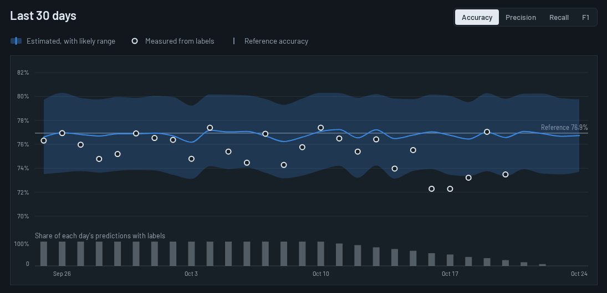

# Sentinel

Monitoring for machine learning models in production, built around the question most tools
leave open: **how is the model doing before the labels come back?**

Sentinel estimates a classifier's accuracy from its own confidence scores, checks that estimate
against real accuracy once labels arrive, detects when features drift on their own or in how
they relate to each other, and points to the segment of traffic behind a drop.

[](https://github.com/SifatSwapnil2022/sentinel-ai/actions/workflows/ci.yml)

## Status

I'm building this in steps.

| Step | Scope | State |
| --- | --- | --- |
| 1 | `sentinel_core`: drift, performance estimation, slice root cause | Done |
| 2 | Dashboard, on demo traffic run through the engine | Done |
| 3 | Ingestion and query API, storage, background workers | Next |
| 4 | OpenTelemetry ingestion and LLM evaluation | Planned |


## The dashboard

Each model's estimate is drawn as a band (its likely range) with a tick, measured accuracy as a
hollow ring once labels arrive, and the model's accuracy at release as a rule. On the overview
that becomes a forest plot: a model whose band sits left of its rule needs a look, before a
single label has come back.

The demo runs four synthetic models through the real engine, each with a different failure:

| Model | What happens | What Sentinel shows |
| --- | --- | --- |
| credit-risk | Defaults rise for lower-income applicants in one division; inputs look normal | Measured accuracy leaves the estimate's range; root cause names the division |
| fraud-screen | Festival traffic: larger payments, more digital goods; labels take 45 days | Estimated accuracy drops before any labels; no single segment to blame, and the traffic shift behind it |
| claims-triage | A new form decouples claim amount from policy value | Feature relationships change while every feature looks normal |
| churn-predictor | Nothing | Healthy |


Built with React, TypeScript (strict), hand-drawn SVG charts on d3 scales, and runtime schema
validation on every payload. Light and dark themes, keyboard-readable charts, a table view behind
every chart, and phone layouts. Design notes: [`web/DESIGN.md`](web/DESIGN.md).



## What the engine does

**Per-feature drift.** The method is chosen by column type and sample size, following
Evidently's documented defaults: KS / chi-square / Z-test up to 1,000 reference rows,
normalised Wasserstein / Jensen–Shannon above that. PSI is reported for every column.

**Multivariate drift.** A PCA model fitted on reference data reconstructs each window. If
reconstruction error leaves its expected band, the relationships between features have changed,
even when every feature still looks normal by itself.

**Accuracy without labels (CBPE).** Calibrated probabilities give an expected confusion matrix,
and from it accuracy, precision, recall and F1, each with a confidence band. When labels arrive,
`check_concept_drift` compares estimate and reality on the same rows; a gap that leaves the band
means the input–outcome relationship has changed, which input drift tests cannot see.

**Slice root cause.** A drop in a metric is split into "the model got worse in this slice" and
"more traffic came from a harder slice". Slices are ranked by the first part, and a broad slice
is dropped when a narrower one inside it explains most of its drop.

## Example

```python
import numpy as np
from sentinel_core.performance import CBPE, Metric

cbpe = CBPE().fit(y_reference, p_reference)   # labelled reference data
estimate = cbpe.estimate(p_today)             # today's scores, no labels yet
acc = estimate[Metric.ACCURACY]
print(f"estimated {acc.value:.3f}  band [{acc.lower:.3f}, {acc.upper:.3f}]")
```

On synthetic data with a covariate shift (5,000 rows, inputs moved by one standard deviation):

```text
estimated 0.842  band [0.825, 0.860]
realized  0.842
```

## How it's checked

- **Parity tests.** The same data goes through Sentinel and through the library each method comes
  from. KS, chi-square, Z-test, Wasserstein and Jensen–Shannon values match Evidently, and CBPE
  estimates and sampling errors for all four metrics match NannyML to within 1e-9, with and
  without calibration (`make parity`).
- **Property tests** (Hypothesis): the slice decomposition always sums exactly to the observed
  change; PSI is never negative; Jensen–Shannon is symmetric and bounded; identical windows never
  drift.
- **Statistical tests**: the 3-sigma accuracy band covers the realized value in at least 97% of
  300 simulated windows; the multivariate detector raises at most 2 false alarms in 40 clean
  windows; the calibration noise floor matches simulation within 15%.
- **Realistic traffic.** Running the demo scenarios through the engine exposed three problems the
  unit tests had not, each now fixed and tested ([ADR 5](docs/adr/0005-calibration-and-concept-band.md)).
- **Dashboard**: 55 unit and component tests, a contract test that every generated JSON file
  passes the dashboard's schemas, and 53 Playwright tests on desktop and phone covering the main
  journeys, keyboard access to charts, no sideways scrolling, and zero serious axe accessibility
  violations in light and dark mode.
- Strict mypy and TypeScript, ruff and ESLint, CI on Python 3.11–3.13 and Node 22.

## Run it

Requires [uv](https://docs.astral.sh/uv/) and Node 22.

```bash
make install            # Python environment
make check              # lint, types, tests with coverage
make parity             # compare with Evidently and NannyML (separate environment)
make fixtures           # regenerate the dashboard's demo data from the engine

cd web && npm ci
npm run dev             # dashboard at http://localhost:5173
npm run check && npm run e2e
```

## Design decisions

Each choice and its trade-off is written down in [`docs/adr`](docs/adr):

1. [Monorepo with a dependency-free core](docs/adr/0001-core-package.md)
2. [Drift methods and fixed PSI bins](docs/adr/0002-drift-methods.md)
3. [Multivariate drift with a held-out band](docs/adr/0003-multivariate-drift.md)
4. [Performance estimation and the concept-drift flag](docs/adr/0004-performance-estimation.md)
5. [Calibration rule, concept-drift band, slice concentration](docs/adr/0005-calibration-and-concept-band.md)

## Limits

- Performance estimation covers binary classifiers. Multiclass and regression (DLE) are planned.
- CBPE assumes the input–outcome relationship is stable; that is what the concept-drift check
  is for, but it needs labels to fire.
- The slice search looks at single features and pairs, not deeper combinations.

## License

MIT
