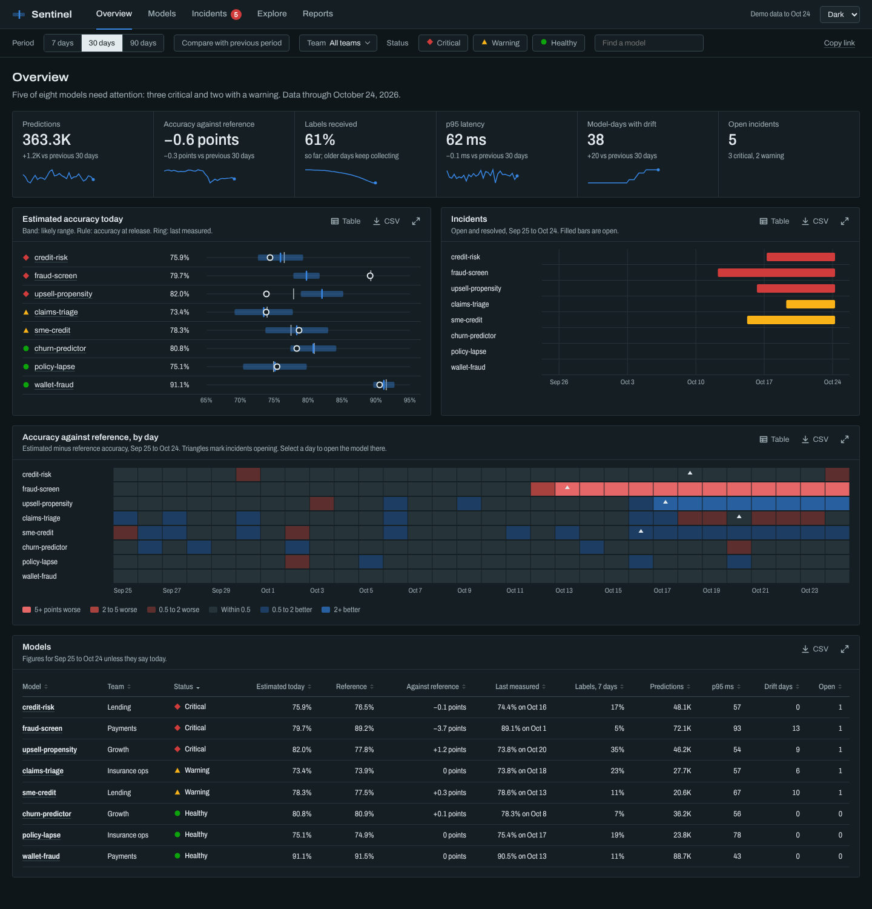
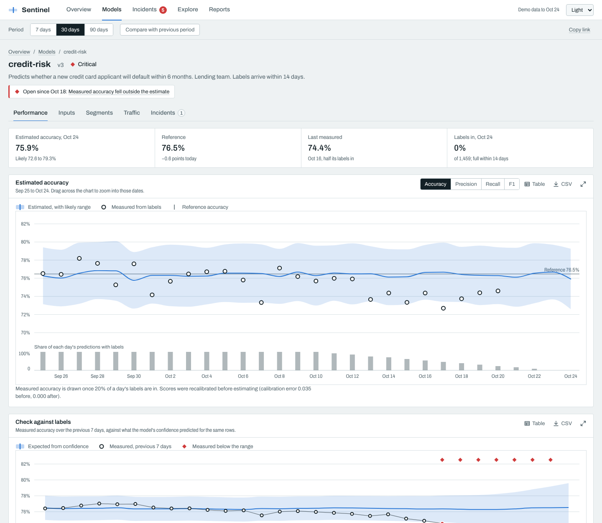
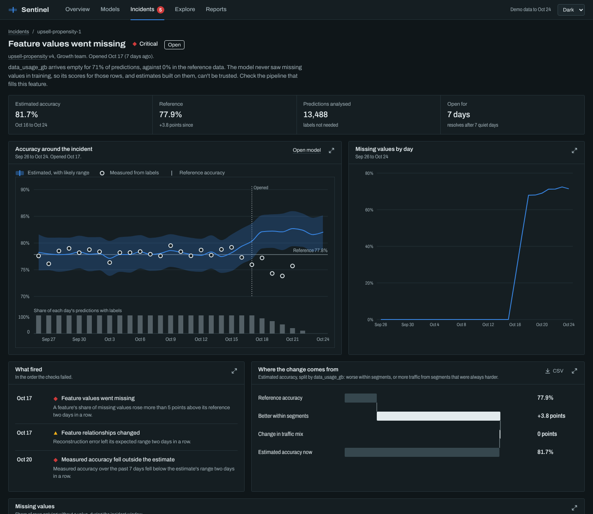
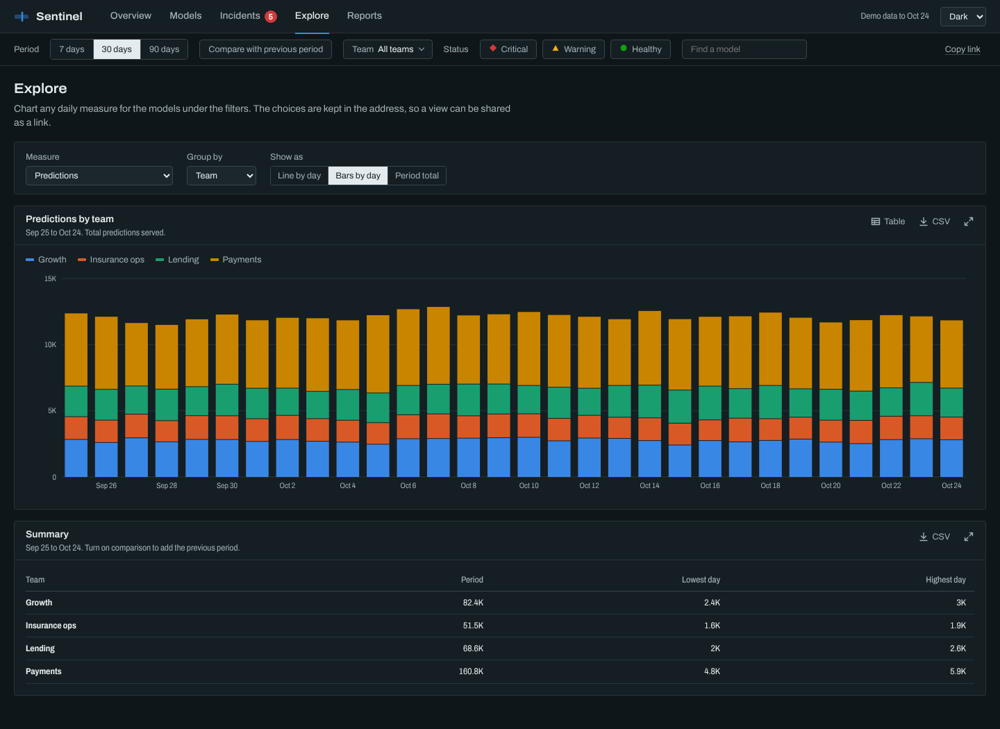
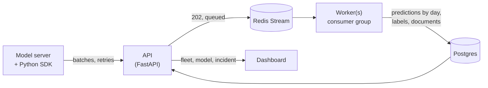

# Sentinel

Monitoring for machine learning models in production, for the case where labels arrive late.
A fraud model finds out it was wrong when the chargeback comes in, a credit model when the loan
defaults. Until then, the accuracy on a dashboard is weeks old.

Sentinel estimates each day's accuracy from the model's calibrated scores, checks that estimate
against measured accuracy once labels arrive, watches inputs for drift, broken relationships and
missing values, and points to the segment of traffic behind a drop. The numbers are also
published as a star schema, with a Power BI project and a Tableau workbook on top.

**Demo: [sentinel-ai-sage-gamma.vercel.app](https://sentinel-ai-sage-gamma.vercel.app/)**, with
the [dashboard](https://sentinel-ai-sage-gamma.vercel.app/overview) running on 90 days of
synthetic traffic for eight models.

[](https://github.com/SifatSwapnil2022/sentinel-ai/actions/workflows/ci.yml)

## Status

| Step | Scope | State |
| --- | --- | --- |
| 1 | `sentinel_core`: drift, performance estimation, slice root cause | Done |
| 2 | Dashboard on demo traffic run through the engine | Done |
| 3 | Ingestion and query API, storage, background workers, Python SDK | Done |
| 4 | Incident history, data quality check, BI dashboard, star schema exports, Power BI and Tableau | Done |
| 5 | OpenTelemetry ingestion and LLM evaluation | Planned |



## The dashboard

| Page | What it shows |
| --- | --- |
| Overview | Fleet KPIs with the previous period, each model's estimate against its reference (a forest plot), an incident timeline, and a models × days heatmap of accuracy against reference |
| Models | Every model by team, with a trend line and its current state |
| Model | Tabs for performance (estimate, measured accuracy, label check), inputs (drift heatmap, reconstruction error, missing values, distributions), segments, traffic and incidents |
| Incidents | Open and resolved incidents, with a timeline |
| Incident | What fired and when, accuracy around the incident, where the change comes from, the segments that cost the most, example rows |
| Explore | Any daily measure, grouped by model, team or fleet, as lines, stacked bars or period totals |
| Reports | The CSV tables, the Power BI project and the Tableau workbook |

The period, date range, comparison, team, status and search slicers are kept in the address,
so any view can be shared as a link. Every chart has a table view and a CSV download, dragging
across the accuracy chart zooms to those dates, and heatmap cells drill into the model or feature
behind them.

Estimates are always drawn with their likely range (a band), measured accuracy as a ring once
labels arrive, and the model's accuracy at release as a rule. Design notes:
[`web/DESIGN.md`](web/DESIGN.md).



The demo's eight models each tell a different story:

| Model | What happens | What Sentinel shows |
| --- | --- | --- |
| credit-risk | Defaults rise for lower-income applicants in one division; inputs look normal | The label check fails; root cause names the division |
| fraud-screen | Festival traffic: larger payments, more digital goods; labels take 45 days | The estimate drops weeks before labels could show it, with the traffic shift behind it |
| claims-triage | A new form decouples claim amount from policy value | Feature relationships change while every feature looks normal |
| upsell-propensity | A billing-system change leaves `data_usage_gb` empty for 70% of rows | A data quality incident the next day, while the estimate goes *up* |
| sme-credit | Eid stock-up: bigger loans and more retail applicants, repayment unchanged | Input drift with a warning, not a critical incident: accuracy holds |
| policy-lapse | Monsoon floods: more cash payments and missed instalments for about two weeks, then back to normal | An incident that opened and resolved by itself |
| churn-predictor, wallet-fraud | Nothing | Healthy, with no incident in 90 days |



Built with React 19, TypeScript (strict), SVG charts drawn on d3 scales, React Router, TanStack
Query, and Zod validation of every payload. Dark and light themes, keyboard-readable charts,
phone layouts.

## BI tables, Power BI and Tableau

The numbers behind the dashboard are seven CSV tables in a star schema (two dimensions, five
facts), built from the same documents the dashboard reads, so a report and the dashboard always
agree. The demo serves them as static files; a running API serves them at
`/v1/export/<table>.csv`. Columns are documented in [`docs/bi.md`](docs/bi.md).

- [`bi/powerbi`](bi/powerbi): a Power BI project (PBIP) with a TMDL semantic model
  (relationships, a date table and weighted measures) and three report pages. A `DataUrl`
  parameter switches it between the demo and a live API.
- [`bi/tableau`](bi/tableau): a Tableau workbook with three sheets and a dashboard. The packaged
  `.twbx` on the Reports page includes the data.

Both are generated by [`bi/build_bi.py`](bi/build_bi.py), so they diff cleanly and stay in step
with the tables. CI checks they are current and validates the Power BI JSON against Microsoft's
published schemas. Neither can be opened in CI, so rendering is checked in the desktop tools.



## Architecture



- **Ingest never slows the model server.** The SDK only appends to a bounded buffer; a background
  thread sends batches and backs off. The API validates and queues; it never waits on Postgres.
  When the backlog grows, it answers `503 Retry-After` instead of growing Redis without bound.
- **At-least-once and idempotent.** A stream entry is acknowledged only after its transaction
  commits; retried writes change nothing. Entries a crashed worker held are reclaimed; entries
  that keep failing go to a dead-letter stream with the reason.
- **Documents are materialised.** A write marks the days it affects (its own, and the next six
  for the rolling label check). Workers recompute them, rebuild the model page and incident, and
  reads are a primary-key lookup.
- **Incidents open after two days and resolve after a quiet week**, because the newest days'
  labels are always the last to arrive, and a quiet day early on is often just missing labels.
  The full history is derived from the daily documents, so resolved incidents stay on record.

The [API reference](docs/api.md) covers endpoints, limits and every error type;
[ADR 7](docs/adr/0007-server-architecture.md) the trade-offs.

```python
from sentinel_sdk import Sentinel

sentinel = Sentinel("https://sentinel.example.com", api_key, model_id="credit-risk")
sentinel.log_prediction(request_id, features, score=0.82, latency_ms=31.0)  # microseconds; never raises
sentinel.log_label(request_id, 1)  # whenever the outcome is known
```

## What the engine does

**Per-feature drift.** The method is chosen by column type and sample size, following
Evidently's documented defaults: KS / chi-square / Z-test up to 1,000 reference rows,
normalised Wasserstein / Jensen–Shannon above that. PSI is reported for every column.

**Multivariate drift.** A PCA model fitted on reference data reconstructs each window. If
reconstruction error leaves its expected band, the relationships between features have changed,
even when every feature still looks normal by itself.

**Accuracy without labels (CBPE).** Calibrated probabilities give an expected confusion matrix,
and from it accuracy, precision, recall and F1, each with a confidence band. When labels arrive,
`check_concept_drift` compares estimate and reality on the same rows; measured accuracy below the
band means the input–outcome relationship has changed, which input drift tests cannot see.
Measured accuracy above the band is shown but not alerted on.

**Missing values.** A feature whose share of empty values rises more than 5 points above its
reference opens a data quality incident (critical above 25). It is separate from drift because
the values that are present can look perfectly normal.

**Slice root cause.** A drop in a metric is split into "the model got worse in this slice" and
"more traffic came from a harder slice". Slices are ranked by the part of their drop that is
statistically clear (the lower edge of a 95% interval), so a small segment with an unmistakable
drop beats a larger, noisier one; a broad slice is dropped when a narrower one inside it explains
most of its drop.

## Example

```python
import numpy as np
from sentinel_core.performance import CBPE, Metric

cbpe = CBPE().fit(y_reference, p_reference)   # labelled reference data
estimate = cbpe.estimate(p_today)             # today's scores, no labels yet
acc = estimate[Metric.ACCURACY]
print(f"estimated {acc.value:.3f}  band [{acc.lower:.3f}, {acc.upper:.3f}]")
```

On synthetic data with a covariate shift (5,000 rows, inputs moved by one standard deviation):

```text
estimated 0.842  band [0.825, 0.860]
realized  0.842
```

## How it's checked

- **Parity tests.** The same data goes through Sentinel and through the library each method comes
  from. KS, chi-square, Z-test, Wasserstein and Jensen–Shannon values match Evidently, and CBPE
  estimates and sampling errors for all four metrics match NannyML to within 1e-9, with and
  without calibration (`make parity`).
- **Property tests** (Hypothesis): the slice decomposition always sums exactly to the observed
  change; PSI is never negative; Jensen–Shannon is symmetric and bounded; identical windows never
  drift.
- **Statistical tests**: the 3-sigma accuracy band covers the realized value in at least 97% of
  300 simulated windows; the multivariate detector's daily false-alarm rate stays at or below
  1.5% over 400 clean days (it was 6.5% before [ADR 6](docs/adr/0006-false-alarms-and-detection-power.md));
  the calibration noise floor matches simulation within 15%.
- **Live equals static.** A parity test sends four demo scenarios through the whole service
  (CSV upload, HTTP ingest, Redis, worker, Postgres, read API) and requires every document,
  incident and daily row to equal the in-memory result exactly.
- **False alarms and detection.** Three random seeds, eight models, 90 days each: no incident
  before an injected change or on a model without one; every injected problem opened an incident
  one to four days after it started; the temporary shift resolved by itself
  ([ADR 6](docs/adr/0006-false-alarms-and-detection-power.md), [ADR 8](docs/adr/0008-episodes-data-quality-bi.md)).
- **Python**: 271 tests (155 core, 100 server against real Postgres and Redis, 16 SDK). Server
  tests cover auth and scopes, every validation path, idempotent retries, labels before
  predictions, dead-lettering, stream trimming, partition retention, incident history and the
  CSV exports. Coverage is 96%.
- **Web**: 129 unit and component tests, including a contract test that every generated JSON
  file passes the dashboard's schemas, and 126 Playwright tests on desktop and phone: the journey
  from the landing page to an incident's cause, slicers surviving navigation, brushing, CSV
  downloads, keyboard access to charts, no sideways scrolling, and no serious axe violations on
  any page in either theme.
- Strict mypy and TypeScript, ruff and ESLint, CI on Python 3.11–3.13 and Node 22.

## Run it

The whole stack in Docker (dashboard on http://localhost:8080, API on http://localhost:8000):

```bash
make up                 # Postgres, Redis, API, worker, dashboard
make demo               # stream the demo scenarios in through the SDK
make down
```

For development, with [uv](https://docs.astral.sh/uv/) and Node 22:

```bash
make install            # Python environment
make check              # lint, types, tests with coverage
                        # server tests need Postgres and Redis: set SENTINEL_TEST_DATABASE_URL
                        # and SENTINEL_TEST_REDIS_URL, or they are skipped
make parity             # compare with Evidently and NannyML (separate environment)
make fixtures           # regenerate the demo data, BI tables and BI reports

cd web && npm ci
npm run dev             # http://localhost:5173 (dashboard at /overview), on the bundled demo data
VITE_SENTINEL_API=http://localhost:8000 npm run dev   # ... or on a live API
npm run check && npm run e2e
```

## Design decisions

Each choice and its trade-off is written down in [`docs/adr`](docs/adr):

1. [Monorepo with a dependency-free core](docs/adr/0001-core-package.md)
2. [Drift methods and fixed PSI bins](docs/adr/0002-drift-methods.md)
3. [Multivariate drift with a held-out band](docs/adr/0003-multivariate-drift.md)
4. [Performance estimation and the concept-drift flag](docs/adr/0004-performance-estimation.md)
5. [Calibration rule, concept-drift band, slice concentration](docs/adr/0005-calibration-and-concept-band.md)
6. [False alarms and detection power](docs/adr/0006-false-alarms-and-detection-power.md)
7. [Server architecture: queued ingest, materialised documents, incident lifecycle](docs/adr/0007-server-architecture.md)
8. [Incident history, data quality, one-sided label check, BI tables](docs/adr/0008-episodes-data-quality-bi.md)

## Limits

- Performance estimation covers binary classifiers. Multiclass and regression (DLE) are planned.
- CBPE assumes the input–outcome relationship is stable; that is what the concept-drift check
  is for, but it needs labels to fire.
- The slice search looks at single features and pairs, not deeper combinations.
- Features are stored as `jsonb`, which is comfortable to millions of predictions a day per
  model. Beyond that, a columnar store is the next step ([ADR 7](docs/adr/0007-server-architecture.md)).
- The compose file is for one machine and has no TLS or user accounts; API keys are the only
  access control.
- The data quality threshold is the same for every feature; there is no per-feature setting yet.
- All demo traffic is synthetic. The analysis is the same code the service runs.

## License

MIT
